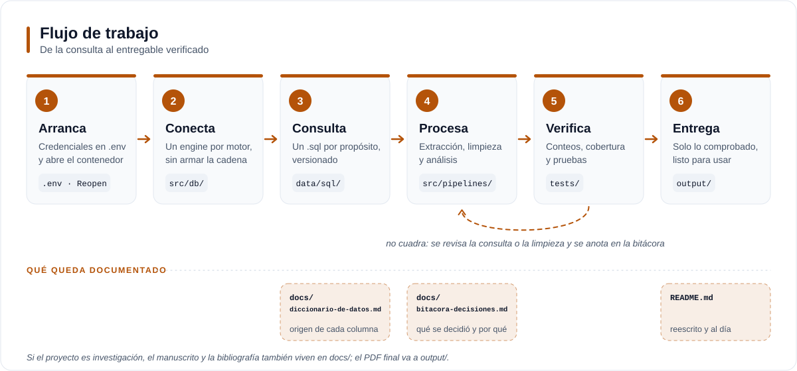

<div align="center">


<p>
  
  
  
  
  <!-- Default activo: SQL Server (pyodbc). PostgreSQL y Oracle vienen comentados en src/db/connection.py, .env.example y el Dockerfile — cambiar de motor es descomentar. -->
  
  
</p>

<p><em>Análisis de datos en Python con conexión a SQL — de la consulta al hallazgo.</em></p>

<a href="#-instalación-y-uso"><b>Instalación</b></a> &nbsp;·&nbsp; <a href="#-conexión-a-sql"><b>Conexión a SQL</b></a> &nbsp;·&nbsp; <a href="#-estructura-del-proyecto"><b>Estructura</b></a> &nbsp;·&nbsp; <a href="./README_AGENTS.md"><b>Contrato de trabajo</b></a>

</div>

<br>

Plantilla **reproducible, ligera y portable** para análisis de datos en Python **con conexión a bases
de datos SQL**, sobre **VS Code + Dev Containers + Docker + `uv`**. Entorno aislado y consistente, sin
instalar el toolchain del proyecto en tu máquina anfitriona.

> **Armada con SQL Server como ejemplo activo.** PostgreSQL y Oracle vienen **comentados** en
> `src/db/connection.py`, `requirements.txt`, `.env.example` y el `Dockerfile` — cambiar de motor es
> descomentar (ver [Conexión a SQL](#-conexión-a-sql)).

> **¿Buscas cómo trabajamos día a día (la dinámica agente ⇄ tú)?** Eso vive en **[`README_AGENTS.md`](./README_AGENTS.md)**.
> Este archivo es el *qué es y cómo se instala*.

---

## 🔄 Flujo de trabajo

Igual que en el análisis sin SQL, con dos piezas propias: la conexión (`src/db/`) y el catálogo de consultas (`data/sql/`).

<picture>
  <source media="(prefers-color-scheme: dark)" srcset="./assets/diagramas/flujo-trabajo-oscuro.svg">
  
</picture>

---

## ✅ Requisitos previos

- **Docker** en ejecución (en Windows, vía **WSL2**).
- **Visual Studio Code** con la extensión **Dev Containers** (`ms-vscode-remote.remote-containers`).
- **Git**.

No necesitas Python, `uv` ni el driver ODBC instalados en el host: viven dentro del contenedor.

---

## 🚀 Instalación y uso

### 1. Clona el repositorio

**Por HTTPS:**

```bash
git clone https://github.com/ClearNote97/ClearNote_Py_DA_SQL.git
cd ClearNote_Py_DA_SQL
```

**Por SSH:**

```bash
git clone git@github.com:ClearNote97/ClearNote_Py_DA_SQL.git
cd ClearNote_Py_DA_SQL
```

### 2. Elimina el historial de la plantilla

Esto es una **plantilla, no un proyecto en sí**: soltar el historial git que trae es **obligatorio**.

```bash
rm -rf .git
```

### 3. Renombra la carpeta

Ponle el nombre de tu proyecto (reemplaza `nuevo_nombre`):

```bash
cd ..
mv ClearNote_Py_DA_SQL nuevo_nombre
cd nuevo_nombre
```

> El nombre de la carpeta es también el del devcontainer y el del contenedor (`<carpeta>_dev`):
> **sin espacios** (usa `_` o `-`), porque Docker no los admite en nombres de contenedor.

### 4. Inicializa tu propio repositorio *(opcional)*

```bash
git init
git add .
git commit -m "Proyecto inicial basado en la plantilla ClearNote Py DA SQL"
```

Y, si quieres conectarlo a un remoto:

```bash
git remote add origin https://github.com/tu_usuario/tu_repositorio.git
git push -u origin main
```

### 5. Abre en el contenedor

En VS Code: **Ctrl+Shift+P → Reopen in Container**. Espera a que termine el `postCreateCommand`
(prepara `.venv` e instala/sincroniza dependencias con `uv`). **No corras `pip install` a mano.**
Al final corre el **smoke test** (sintaxis + guard de conexión a SQL Server, sin conectarse); puedes
repetirlo cuando quieras con `bash scripts/smoke-test.sh`.

---

## ⚙️ Especificaciones técnicas

### Contenedor

| | |
|---|---|
| Imagen base | `python:3.14.5-slim-bookworm` (Debian 12) |
| Paquetes de sistema | `build-essential`, `ca-certificates`, `curl`, `gnupg`, `unixodbc-dev` |
| Driver SQL Server | `msodbcsql17` (repo de Microsoft para Debian 12, instalado vía *keyring*) |
| Gestor de dependencias | `uv` `0.11.13` (copiado desde `ghcr.io/astral-sh/uv`) |
| Usuario | `root` |
| Workspace | `/workspaces/<nombre-de-la-carpeta>` |
| Entorno virtual | `.venv/` (intérprete: `${workspaceFolder}/.venv/bin/python`) |

### Gestión de dependencias con `uv`

`uv` reemplaza a `pip` como herramienta de trabajo. Al crear el contenedor, el `postCreateCommand`
detecta el estado del proyecto y actúa solo:

| Estado del repo | Qué ejecuta |
|---|---|
| Hay `pyproject.toml` **y** `uv.lock` | `uv sync --locked` |
| Hay `pyproject.toml` **sin** `uv.lock` | `uv lock && uv sync` |
| Solo `requirements.txt` | `uv init --no-package --no-workspace .` → borra `main.py` → `uv add -r requirements.txt` |
| No hay ninguno | Falla con mensaje de error |

> Cuando `uv.lock` se genere o cambie, **se versiona** — es la garantía de reproducibilidad.

### Editor (VS Code)

- **Formateo y linting con Ruff** (al guardar: `fixAll` + `organizeImports`).
- **Type checking**: Pylance en modo `basic`, con *inlay hints*.
- **Extensiones**: Python, Pylance, Ruff, Jupyter, Even Better TOML, Path Intellisense, Material Icon Theme.

---

## 🗄️ Conexión a SQL

El estándar (detallado en [`README_AGENTS.md`](./README_AGENTS.md) §11) es **solo SQLAlchemy**:

1. **Credenciales en `.env`** → las lee `src/config/config.py` (prefijo por motor, `MSSQL_`; nunca `DB_`).
2. **Fábrica de engine en `src/db/connection.py`** → `get_engine_mssql()` arma la URL con `URL.create()`.
3. **Consultas en `data/sql/*.sql`** (nunca SQL embebido en Python).
4. **Ejecución con pandas** → `pd.read_sql(query, engine)`.

**Cambiar de motor (PostgreSQL / Oracle):** vienen comentados. Para activar uno:

1. Descomenta su función en `src/db/connection.py` (`get_engine_postgres()` / `get_engine_oracle()`).
2. Descomenta su paquete en `requirements.txt` (`psycopg[binary]` / `oracledb`).
3. Descomenta su grupo de variables en `config.py` y `.env`.
4. Si aplica, descomenta sus *system deps* en `.devcontainer/Dockerfile`.

| Motor | Dialecto | Paquete | System deps |
|---|---|---|---|
| SQL Server *(activo)* | `mssql+pyodbc` | `pyodbc` | `unixodbc-dev` + `msodbcsql17` |
| PostgreSQL | `postgresql+psycopg` | `psycopg[binary]` | ninguna (binary) |
| Oracle | `oracle+oracledb` | `oracledb` | ninguna en modo *thin* |

> **`MSSQL_NAME`/`MSSQL_PORT` son opcionales.** `MSSQL_PORT` vacío → `URL.create()` lo omite.
> **"Sin base" ≠ "sin contexto":** SQL Server siempre conecta a *una* base; si dejas `MSSQL_NAME` vacío, usa la
> **base por defecto del login**. Para explorar el servidor sin fijar una, usa `MSSQL_NAME=master`.
> ⚙️ *Nota interna:* SQL Server le entrega a pyodbc el **string ODBC exacto** con `creator=`, no por `URL.create()`: sin
> `MSSQL_NAME`, `URL.create()` caería en el modo DSN de `pyodbc` (ver la fila **IM002** abajo y `src/db/connection.py`).
> La conexión por **túnel SSH** queda comentada (ver `README_AGENTS.md` §11 Caso B); por defecto, conexión directa.

### 🔧 Si la conexión falla (y sigues queriendo SQLAlchemy)

| Síntoma | Causa | Solución |
|---|---|---|
| *"Cannot open database …"* o login falla al no dar base | La base **por defecto** del login no es accesible | `MSSQL_NAME=master` (o una base a la que sí tengas acceso) |
| **`IM002`** *"data source name not found and no default driver"* **sin dar base** | Heurística DSN de `pyodbc`: con `host` y sin `database`, `URL.create()` renderiza `dsn=<host>` y **descarta el `DRIVER=`** (ni `None` ni `""` lo evitan) | **Ya resuelto en la plantilla:** `get_engine_mssql()` arma el string ODBC (`mssql_connection_string()`) y se lo entrega a pyodbc con `creator=`. Si lo ves, alguien volvió a `URL.create()` para SQL Server (el smoke test lo detecta) |
| *"Data source name not found / driver not found"* | `MSSQL_DRIVER` ≠ el driver instalado en el contenedor | Ajusta `MSSQL_DRIVER` al real (hoy el Dockerfile trae `msodbcsql17`) |
| Error **TLS / certificado** (típico con Driver 18) | `Encrypt=yes` contra un cert autofirmado | `MSSQL_ENCRYPT=yes` **+** `MSSQL_TRUST_SERVER_CERT=yes` |
| *"En pyodbc funciona pero aquí no"* | El string de pyodbc traía un parámetro que el nuestro no | Agrégalo a `parts` en `mssql_connection_string()`: es el string exacto que recibe pyodbc — **no abandonas SQLAlchemy** |

---

## 📂 Estructura del proyecto

```
.
├── .devcontainer/      # Dockerfile + devcontainer.json (entorno + driver ODBC)
├── data/
│   ├── sql/            # catálogo de consultas .sql (solo .sql, sin código)
│   └── other/          # datos en formatos no-SQL (.csv, .parquet, .xlsx, …)
├── assets/             # lo visual del proyecto: marca · imagenes · iconos · fuentes · diagramas
├── docs/               # documentación: bitácora de decisiones, diccionario de datos
├── notebooks/          # exploración y prototipado (.py / .ipynb)
├── scripts/            # run_pipeline.py (entrada del pipeline) · smoke-test.sh (salud del proyecto)
├── sandbox/            # experimentos desechables — su contenido NO se versiona
├── tests/              # verificación formal (pytest) — el gate
├── output/             # entregable final, ya verificado
├── src/
│   ├── config/         # config.py (lee credenciales del .env)
│   ├── db/             # connection.py (fábrica de engines SQLAlchemy)
│   ├── pipelines/      # lógica del pipeline
│   └── utils/          # utilidades de datos (limpieza, formato, índices)
├── .env.example        # plantilla de variables de entorno (copiar a .env)
├── requirements.txt    # dependencias (base para pyproject.toml + uv.lock)
├── README.md           # este archivo
└── README_AGENTS.md     # el contrato de trabajo (dinámica agente ⇄ tú)
```

**Flujo de trabajo:** `sandbox/` (tanteo) → `tests/` (gate) → `output/` (solo lo verificado). Cada carpeta tiene su `README.md`.

---

## 🧹 Qué se versiona y qué no

**Se versiona:** `README.md`, `README_AGENTS.md`, `.devcontainer/*`, `requirements.txt` (o `pyproject.toml`), `uv.lock` cuando exista, `tests/`, `output/`, los `README.md` de cada carpeta, `data/sql/*.sql`.

**No se versiona:** `.venv/`, `__pycache__/`, `*.pyc`, `.env`, y el **contenido** de `sandbox/`.

```gitignore
.env
__pycache__/
*.pyc
.venv/

# sandbox/: la carpeta y su README viajan; el contenido (experimentos) no se versiona
sandbox/*
!sandbox/README.md
```

> El `.env` **nunca** se versiona. Usa `.env.example` como referencia.

---

## 📦 Dependencias incluidas

- **Análisis de datos:** `pandas`, `numpy`, `pyarrow`
- **Excel:** `openpyxl`, `xlsxwriter`, `xlrd`, `fastexcel`
- **Base de datos:** `sqlalchemy`, `pyodbc` (SQL Server) — `psycopg[binary]` / `oracledb` comentados
- **Notebooks / interactivo:** `ipython`, `ipykernel`, `ipynbname`
- **Utilidades:** `python-dateutil`, `python-dotenv`

---

<div align="center">

<sub>Distribuido bajo licencia <a href="https://opensource.org/license/MIT">MIT</a> · Puedes copiar, modificar y reutilizar libremente esta plantilla.</sub><br>
<sub>Hecho por <b>MSc. Nicolás Enrique Valencia Santiago</b> · Enriquecido con <a href="https://github.com/ftuga/helix_asisten">Helix</a>, el agente de IA de <a href="https://github.com/ftuga">ftuga</a>.</sub>

</div>
